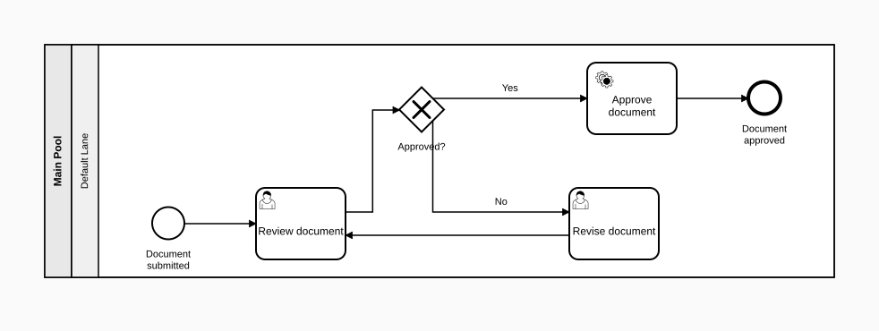
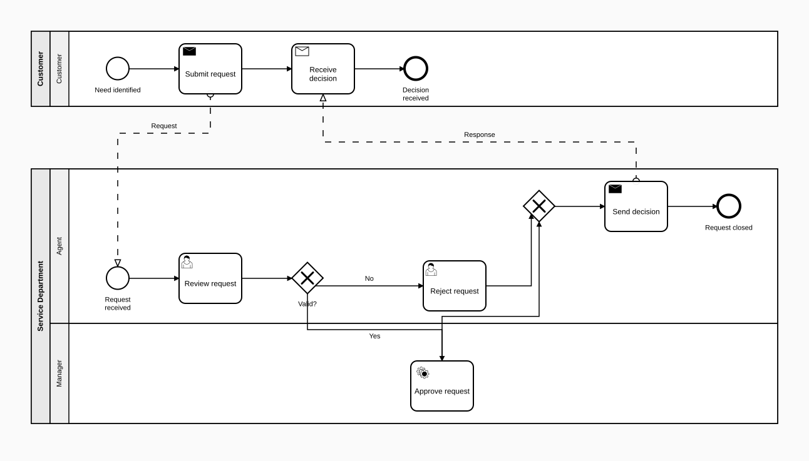
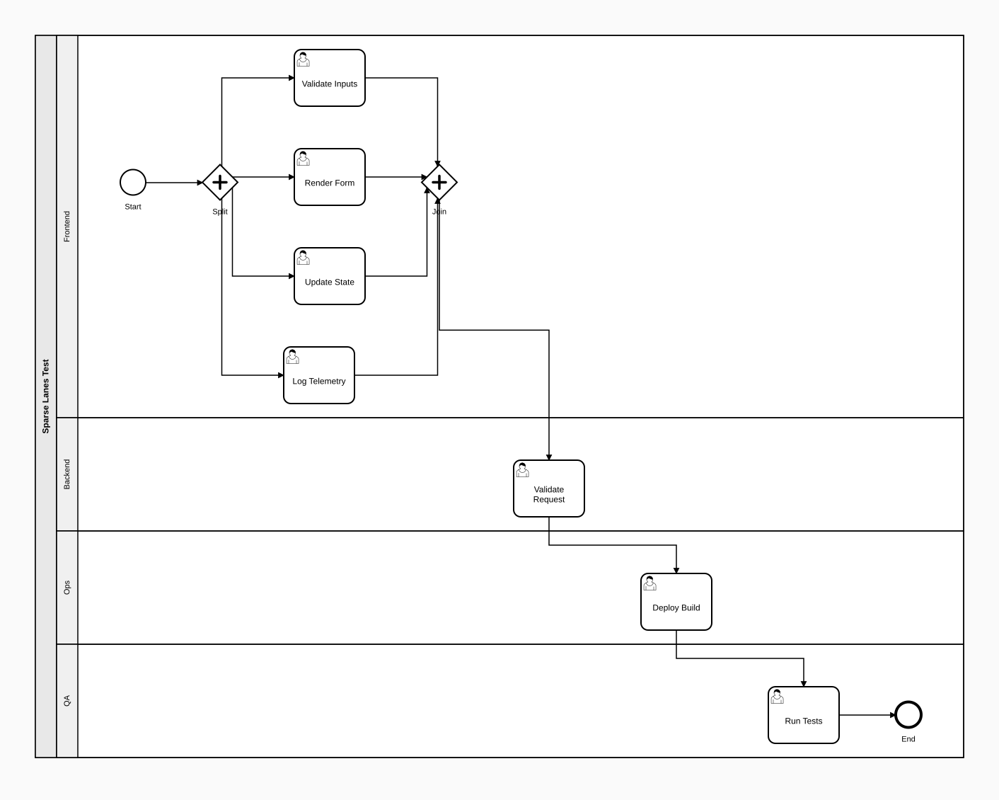
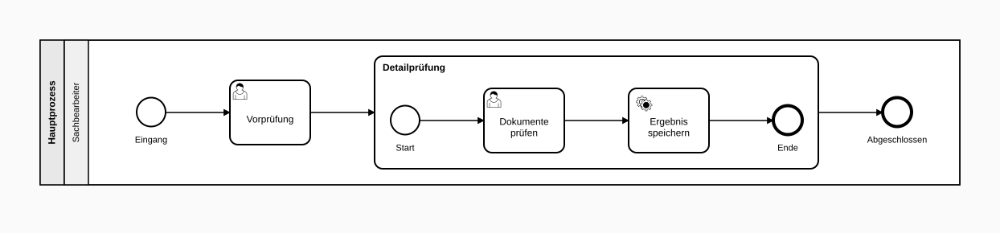

# BPMN Generator

[](https://github.com/Stieges/bpmn-generator/actions/workflows/ci.yml)
[](LICENSE)

BPMN 2.0 diagram generator — converts natural language process descriptions or structured JSON into OMG-compliant BPMN 2.0.2 XML files and SVG previews (ISO/IEC 19510:2013). Also generates DMN 1.3 decision models (opt-in, see [DMN Support](#dmn-support-opt-in)) and enumerates the scenarios a process admits (see [Scenario Enumeration](#scenario-enumeration-opt-in)).

### What's new in 4.0

4.0 changes the default output: lane compaction, edge-label repair, the bend rule, node labels that
avoid flows and the repair of flows through foreign shapes are all on by default, and boundary events
face their target. Rule profiles, HTTP inputs and outbound URLs are hardened, and several options
were removed or renamed (`dynamicLaneHeader`, `visualRefinement.enabled`, the wrapping keys). Every
default change names its rollback switch. The migration notes are the **Breaking** section of the
top entry in [CHANGELOG.md](CHANGELOG.md); read it before upgrading.

## Why this one

Three things you can verify in the repo, not just claim:

1. **Multi-pool collaborations with lanes and message flows render fully.** The closest open-source comparable (`bpmn-auto-layout@1.3.0`, used by [BPMN Assistant](https://github.com/jtlicardo/bpmn-assistant)) silently drops every participant after the first plus all inter-pool message flows ([data](EVALUATION.md#bpmn-auto-layout-comparison)). Our pipeline renders all participants and all message flows.
2. **Strict JSON Schema gate at every HTTP API entry.** LLM output cannot reach the layout engine with malformed Logic-Core — `ajv` draft-2020-12 rejects it at the boundary ([scripts/bpmn/schema-gate.js](scripts/bpmn/schema-gate.js)).
3. **Native Claude Code MCP server.** Exposed as a [Skill](SKILL.md) and via [`scripts/mcp-bpmn-server.js`](scripts/mcp-bpmn-server.js). The LLM never touches coordinates — it emits Logic-Core JSON, the pipeline handles layout deterministically.

Reproduce the comparison: `cd scripts && node bench/compare-bpmn-auto-layout.mjs` — produces [tests/bench/auto-layout-comparison.md](tests/bench/auto-layout-comparison.md) + side-by-side HTML.

See [EVALUATION.md](EVALUATION.md) for the full benchmark, the competitor matrix, and honest notes about where ProMoAI and BPMN Assistant are stronger.

### Visual examples

<table>
<tr>
<td width="50%"><a href="docs/screenshots/01-simple-approval.svg"></a><br><sub>Single-pool linear flow + exclusive gateway</sub></td>
<td width="50%"><a href="docs/screenshots/02-multi-pool-collaboration.svg"></a><br><sub>Two pools, three lanes, message flows — what bpmn-auto-layout drops</sub></td>
</tr>
<tr>
<td><a href="docs/screenshots/03-multi-lane-pool.svg"></a><br><sub>One pool, four lanes (Frontend / Backend / Ops / QA)</sub></td>
<td><a href="docs/screenshots/04-expanded-subprocess.svg"></a><br><sub>Expanded subprocess with inner activities</sub></td>
</tr>
</table>

Full gallery: [docs/screenshots/](docs/screenshots/). All SVGs regenerated from fixtures by the pipeline with default options (lane compaction and label repair on) — they reflect current output, not stale marketing screenshots.

### How we compare (verified)

| Capability | This generator | ProMoAI | BPMN Assistant | BPMN-Chatbot |
|---|---|---|---|---|
| Multi-pool with lanes + message flows | **✅ verified** | ✅ | ❌ (bpmn-auto-layout limitation) | ? |
| Strict JSON Schema input gate (ajv) | **✅** | n/a | partial | partial |
| Soundness check | WF-Net (3 rules, opt-in) | POWL by construction | none | none |
| Configurable rule engine | **40 BPMN rules, 5 layers, JSON profiles** | limited | none | none |
| MCP server | **✅** | ❌ | ❌ | ❌ |
| Stack | Node.js / ES Modules | Python / Streamlit | Python + Vue.js | React + OpenAI |
| License | MIT | GPL-3.0 | MIT-ish | unclear |
| Paper | none (engineering) | IJCAI-24, EMMSAD 2024 | arXiv 2509.24592 | CEUR-WS Vol-3758 |

Each ✅ on our row links back to a fixture, a benchmark, or a source file. See [EVALUATION.md](EVALUATION.md) for cell-by-cell evidence and honest notes on where competitors are stronger (ProMoAI's mathematical soundness guarantee, BPMN Assistant's web UI).

## What It Does

You describe a business process — either as free text or as a structured JSON (Logic-Core) — and the generator produces:

- A **BPMN 2.0 XML file** (.bpmn) that opens in [bpmn.io](https://bpmn.io), Camunda Modeler, or any standard-compliant tool
- An **SVG preview** with all BPMN symbols, lanes, pools, and edge routing
- A **validation report** covering structural correctness, naming conventions, and complexity metrics

The output is structurally valid and OMG-compliant. It handles pools, lanes, gateways, boundary events, sub-processes, message flows, and loop markers correctly — things that LLMs typically get wrong when generating BPMN XML directly.

### Realistic Expectations

This tool produces a **solid first draft**, not a finished diagram. Expect to refine:

- **Layout** — Auto-layout handles most cases well (happy-path alignment, orthogonal routing, lane partitioning), but complex processes with many cross-lane edges or feedback loops may need manual adjustment in a BPMN editor
- **Labels & naming** — The LLM generates reasonable names, but domain-specific terminology may need correction
- **Edge cases** — Unusual gateway patterns, deeply nested sub-processes, or very large diagrams (30+ activities) can produce suboptimal visual results
- **Business logic** — The generator models what you describe; it doesn't validate whether your process makes business sense

Think of it as going from **0% → 80%** in seconds. The remaining 20% is domain expertise that requires human judgment.

## Pipeline

```
User Text → [Phase 1] Intent Extraction (LLM → JSON Logic-Core)
          → [Phase 2] Validation (40 BPMN rules, 5 layers; deadlock detection in the opt-in WF layer)
          → [Phase 3] Auto-Layout (ElkJS Sugiyama layered algorithm + routing repair passes)
          → [Phase 4] Serialization → BPMN 2.0 XML + SVG
```

The LLM **never** handles coordinates. Layout is 100% algorithmic. Two integrity passes run on
every generate call and report separately from the rule engine: the Petri-net translation check
(NC01–NC06, `result.netDiagnostics`) and the post-layout diagram check (DI01–DI11,
`result.diagnostics`) — a green rule engine says nothing about the drawing.

## Quick Start

```bash
cd scripts/
npm install          # installs runtime + dev dependencies (Node >=20)

# Generate from JSON Logic-Core:
node bpmn/pipeline.js my-process.json my-process

# From stdin:
echo '{ ... }' | node bpmn/pipeline.js - output

# Import existing BPMN:
node bpmn/import.js existing.bpmn extracted.json

# DOT export (Graphviz):
node bpmn/pipeline.js my-process.json my-process --dot

# DOT import → Logic-Core JSON:
node bpmn/pipeline.js graph.dot output --import-dot

# Run tests:
npm test
```

**Output:** `output.bpmn` (BPMN 2.0 XML) + `output.svg` (vector preview)

**Flags** of `node bpmn/pipeline.js <input.json | -> [output-basename]`:

| Flag | Effect |
|------|--------|
| `--dot` | Also write a Graphviz DOT export |
| `--import-dot` | Treat the input as DOT and write Logic-Core JSON |
| `--doc` | Also write a Markdown documentation companion |
| `--strict` | Write nothing on any unresolved warning (rule engine, diagram integrity, serialization) |
| `--optimize` | Enable the opt-in Optimization Advisory layer |
| `--refine` | Switch every visual-refinement pass on (lane compaction and label repair already are by default) |
| `--no-refine` | Switch every visual-refinement pass off (mutually exclusive with `--refine`) |
| `--wrap` | Wrap long chains (> 20 nodes) into rows with ELK; independent of `--refine` |
| `--drill-down` | Emit the parent diagram plus one diagram per expanded subprocess |
| `--no-bend-rule` / `--bend-rule` | Switch the bend rule off / force it on (on by default) |
| `--no-label-avoidance` / `--label-avoidance` | Switch off / force on moving event and gateway labels off flows (on by default) |
| `--no-foreign-shape-repair` / `--foreign-shape-repair` | Switch off / force on re-routing flows that run through a foreign shape (on by default) |

All CLI examples in this README run from `scripts/`, like the Quick Start. The CLI also gates on
the two integrity passes: an ERROR from the diagram check (DI) or the net check (NC) aborts, and
`--strict` makes their warnings fatal too (NC INFO findings are printed, never fatal).

### Install as a package

`bpmn-generator` (directory `scripts/`) exports `.` (`runPipeline` and the pipeline modules),
`./import` (`bpmnToLogicCore`), `./validate` (`validateLogicCore`), `./orchestrator`
(`orchestrate`) and `./ontology` (the vocabulary, see below). The package also ships the CLIs
(`bpmn/`, `dmn/`, `scenarios/`), the HTTP and MCP servers and `config.json`. The `rules/` profiles
live outside the package: in an npm install, MCP profile names are refused and file profiles are
read by path.

## Usage as Claude Code Skill

### In a specific project

Copy `SKILL.md` to `.claude/skills/operative/bpmn-prozess-erstellen.md` and adjust the relative paths for `references/` and `scripts/` to match where you placed those directories.

### As a portable .skill file

`cd scripts && npm run build:skill` produces `bpmn-generator.skill` at the repo root (gitignored
— rebuild on demand, not committed). The ZIP can be shared with other projects and contains
everything needed:
- `SKILL.md` — Skill definition
- `references/` — schemas, prompt templates, the modelling, DMN, CLI, round-trip and redesign
  guides SKILL.md links to, the inline template
- `scripts/` — the modules the CLIs named in `SKILL.md` and its reference files import
  (`bpmn/pipeline.js`, `bpmn/import.js`, `bpmn/redesign-cli.js`, `dmn/pipeline.js`,
  `dmn/import.js`, `scenarios/pipeline.js` and their import closure), `config.json`, `package.json`

The bundle holds what the skill runs and nothing else: the orchestrator, the HTTP and MCP servers
and `agents/` need a checkout or the npm package, `robustness/` a checkout. The build walks the
imports from every entry point and aborts if one reaches a module it does not bundle.
`npm install --omit=dev` inside the unpacked `scripts/` is still required.

## Module Architecture

The subsystems and their key files. The full per-module inventory, with every module's
dependencies, is the **Architecture** section of [CLAUDE.md](CLAUDE.md) — kept in one place so it
cannot drift in three.

```
scripts/
├── bpmn/         Core BPMN pipeline (runs on every generate call)
│                 pipeline.js (runPipeline + CLI) · validate.js / rules.js (40 BPMN rules) ·
│                 workflow-net.js + net-check.js (Petri net, NC01–NC06) · topology.js ·
│                 layout.js (ElkJS) · coordinates.js · edge-simplify.js, orthogonal-router.js,
│                 bend-rule.js (routing repair) · visual-refinement.js · di-check.js (DI01–DI11) ·
│                 bpmn-xml.js · svg.js · icons.js · dot.js · import.js / moddle-import.js
│                 (BPMN → Logic-Core) · schema-gate.js · types.js · constants.js ·
│                 optimize.js (O01–O04, opt-in) · scenario-rules.js (SC01, SC06)
│                 redesign-cli.js, redesign.js, redesign-core.js — redesign toolbox (opt-in)
├── dmn/          DMN 1.3 pipeline (opt-in; runPipeline reaches only the table text)
│                 pipeline.js (runDmnPipeline + CLI) · rules.js (19 DMN rules) · layout.js ·
│                 coordinates.js · di-check.js (DD01–DD03) · dmn-xml.js · svg.js + pathmap.js
│                 (DRD SVG) · table.js, table-text.js, table-svg.js, table-html.js, doc.js
│                 (decision tables) · load-decisions.js · import.js +
│                 import-scope.js (DMN → Decision-Core, IM01–IM09) · scenario-rules.js (SC04, SC05)
├── scenarios/    Scenario enumeration (opt-in): pipeline.js (runScenarioPipeline + CLI),
│                 enumerate.js, collaboration.js, decision-table.js, bridge.js, format.js
├── cross/        Cross-notation: rules.js (SC02, SC03 — decisionRef ↔ DMN), decision-doc.js
│                 (a Business Rule Task's decision table in its documentation)
├── shared/       Format-independent core: utils.js (config), ontology.js, rule-profile.js,
│                 rule-catalog.js, resource-paths.js, geometry.js, text-layout.js, outbound-url.js (SSRF guard),
│                 safe-text.js, entry-point.js, version.js
├── agents/       Multi-agent orchestration: modeler.js, reviewer.js, layout.js, compliance.js,
│                 chat.js, prompt-sections.js, llm-provider.js
├── robustness/   Synthetic-data + benchmarking subsystem (see its README.md)
├── orchestrator.js           Multi-agent state machine + CLI
├── http-server.js            HTTP API (8 endpoints)
├── mcp-bpmn-server.js        MCP server (4 tools)
├── audit.js, delivery.js     Audit log, webhook delivery + dead letter
├── evaluate-slm.js, prepare-training-data.js   SLM evaluation and training-data prep
├── config.json               Externalized constants (shapes, colors, gaps, switches)
└── package.json              Runtime deps: elkjs, bpmn-moddle, dmn-moddle, @modelcontextprotocol/sdk, ajv, ajv-formats
```

Run `cd scripts && npm test` for the current test count (Jest, ES Modules) — it changes often enough
that a number here would go stale immediately; CI enforces it stays green.

The import graph is acyclic. `dmn/` never imports `bpmn/`; `bpmn/` imports only
`cross/decision-doc.js` (from `pipeline.js`, for the `decisions` option — no rule module of another
notation is in `runPipeline`'s import closure); `shared/` imports neither; `scenarios/` and `cross/`
are the only places the two notations meet.

## Repo Structure

```
bpmn-generator/
├── README.md, CHANGELOG.md, ROADMAP.md   Overview, version history, roadmap
├── SKILL.md                              Claude Code skill definition
├── CLAUDE.md, AGENTS.md                  Instructions for coding agents
├── CONTRIBUTING.md, SECURITY.md          Contribution guide, threat model + dependency policy
├── COMPATIBILITY.md, EVALUATION.md       bpmn.io compatibility report, benchmark + competitor matrix
├── LICENSE, THIRD-PARTY-NOTICES.md       MIT license, dependency licenses
├── .github/                              CI workflows and the docs gate
├── references/
│   ├── input-schema.json                 Logic-Core JSON Schema (draft 2020-12); prose in logic-core-schema.md
│   ├── decision-core-schema.json         Decision-Core (DMN) JSON Schema
│   ├── ontology.jsonld                   Vocabulary + rule catalog (node types, markers, rules, layers)
│   ├── rule-profile-schema.json          Schema every rule profile must pass
│   ├── api-reference.md, api-schema.json HTTP/MCP reference and the response contract
│   ├── fachliches-regelwerk.md           Rule documentation (authoritative catalog, per-rule sources)
│   ├── omg-compliance.md                 OMG BPMN 2.0.2 compliance mapping
│   ├── prompt-template.md                LLM prompt templates + few-shot patterns
│   ├── inline-template.md                HTML template for browser-side ElkJS
│   ├── omg-spec/                         Normative DMN 1.3 XSDs
│   └── review-set/                       Fixtures for visual review
├── rules/                                Rule profiles (default, strict, DMN default/best-practice; custom/)
├── scripts/                              Pipeline modules (see above)
├── docs/                                 Screenshots, guides, design specs and plans
└── tests/
    ├── fixtures/                         Test inputs (Logic-Core, Decision-Core) + golden files
    └── bench/                            Benchmark outputs (e.g. the bpmn-auto-layout comparison)
```

## Rule Engine

40 BPMN rules across 5 layers with configurable severity via JSON profiles (2 are registered as placeholders; SC01 and SC06 run in the scenario pipeline and are not profile-switchable yet). The authoritative catalog lives in [`references/fachliches-regelwerk.md`](references/fachliches-regelwerk.md); this README does not duplicate per-rule descriptions.

| Layer | Severity | Rules | Examples |
|-------|----------|-------|----------|
| Soundness | ERROR | S01-S17 | Start/End events, deadlocks, boundary events |
| Style | WARNING | M01-M11 (M05/M06 severity=OFF) | Naming conventions, gateway labels |
| Pragmatics | INFO | P01-P03 | Complexity metrics |
| Workflow-Net | ERROR/WARNING | WF01-WF03 (opt-in); SC01, SC06 (scenario pipeline) | Liveness, boundedness, deadlock-freedom (opt-in) |
| Optimization | ADVISORY | O01-O04 | Redesign opportunities — `optimize`/`soll` mode only (opt-in); each names a transform in the redesign toolbox |

Two more rule sets exist beside it: 19 DMN rules, 3 layers (see [DMN Support](#dmn-support-opt-in))
and 2 cross-notation rules, 1 layer (SC02/SC03, see [Scenario Enumeration](#scenario-enumeration-opt-in)).

**Profiles** (`rules/*.json`) switch layers and rules and override severities. How each interface
takes one:

| Interface | `ruleProfile` |
|---|---|
| CLI | none — the CLI runs the built-in defaults (no profile) |
| Library | `runPipeline(lc, { ruleProfile: '../rules/strict-profile.json' })` (a path) or an inline object |
| HTTP | an inline object only; it may raise soundness rules, never disable the soundness layer or lower one of its rules |
| MCP | a profile *name* resolved inside the repository's `rules/` (refused in an npm install, which has no `rules/`) |

Every profile passes a size/depth bound and `references/rule-profile-schema.json` before a rule
reads it. A profile file that is not JSON, an unknown severity, or `ADVISORY` outside the
optimization layer refuses the profile; an unknown rule id or layer is a warning. The WF layer is
opt-in: it runs only when a profile enables `workflow_net` (`rules/default-profile.json` leaves it
off). See
[`references/fachliches-regelwerk.md`](references/fachliches-regelwerk.md) for full rule
documentation.

## Programmatic API

```javascript
import { runPipeline } from 'bpmn-generator';   // in a checkout: './bpmn/pipeline.js'

const logicCore = { nodes: [...], edges: [...] };
const result = await runPipeline(logicCore);

// result.bpmnXml    — BPMN 2.0 XML string (or null on validation error)
// result.svg        — SVG string
// result.coordMap   — coordinate map
// result.diagnostics — post-layout DI integrity, DI01–DI11 ({ ok, issues }) — separate from
//                       validation, since the rule engine never sees a coordinate
// result.netDiagnostics — Petri-net translation integrity, NC01–NC06 ({ ok, issues }; null when
//                       validation failed) — whether the net the WF rules judge is the model
// result.validation — { errors, warnings, advisories, metrics, xmlWarnings }
//                       xmlWarnings comes from re-parsing the generated XML through bpmn-moddle —
//                       it is what --strict's serialization check gates on
```

Individual modules can be imported directly:

```javascript
import { validateLogicCore } from './bpmn/validate.js';
import { generateBpmnXml } from './bpmn/bpmn-xml.js';
import { generateSvg } from './bpmn/svg.js';
import { logicCoreToDot, dotToLogicCore } from './bpmn/dot.js';
```

### Reading the ontology from another package

The vocabulary (`references/ontology.jsonld`) is exported as `bpmn-generator/ontology`.
Node cannot `import` a `.jsonld` file (`ERR_UNKNOWN_FILE_EXTENSION`); resolve the path and parse it
as plain JSON:

```javascript
import { readFileSync } from 'node:fs';
import { fileURLToPath } from 'node:url';

const path = fileURLToPath(import.meta.resolve('bpmn-generator/ontology'));
const ontology = JSON.parse(readFileSync(path, 'utf8'));   // CommonJS: require.resolve(...)
```

## Features

- **Multi-pool collaborations** with message flows
- **All BPMN 2.0 task types** (User, Service, Script, Send, Receive, Manual, Business Rule)
- **Call Activity, Sub-Process, Transaction** with correct rendering
- **Expanded sub-processes** with inline children
- **Boundary events** (timer, error, message, signal, escalation — interrupting/non-interrupting)
- **All gateway types** with correct `gatewayDirection` (Diverging/Converging/Mixed)
- **Loop/multi-instance markers** (standard loop, parallel MI, sequential MI)
- **Data objects**, data stores, text annotations, groups, associations
- **Collapsed pools** (black-box participants)
- **Roles and systems on an activity** (`role` → BPMN `performer`/`resource`, `system` → extension element; data only, the drawing is unchanged) — to *show* roles and systems as lanes or pools today, see [docs/roles-and-systems.md](docs/roles-and-systems.md)
- **Round-tripping** (BPMN XML → Logic-Core JSON → BPMN XML)
- **DOT format** (Graphviz export + import for visualization)
- **Inline mode** (browser-side ElkJS rendering without Node.js)
- **Configurable rule engine** (40 BPMN rules, 5 layers, JSON profiles — 2 registered as placeholders)
- **Integrity checks on every run** — Petri-net translation (NC01–NC06) and post-layout diagram geometry (DI01–DI11), reported apart from the rule engine
- **Routing repair** — fewest-bends rule, crossing repair with an obstacle-aware orthogonal router, re-routing of flows through foreign shapes, event and gateway labels kept off flows
- **Ontology** — node types, markers and the rule catalog in one JSON-LD file ([`references/ontology.jsonld`](references/ontology.jsonld)), exported as `bpmn-generator/ontology`
- **Redesign toolbox** (5 deterministic process transforms with preview/apply, no LLM — see [Redesign Toolbox](#redesign-toolbox-opt-in))
- **DMN 1.3** decision models with DRD layout, DRD and decision-table SVG, decision tables as Markdown/HTML, and an importer with a loss report — see [DMN Support](#dmn-support-opt-in)
- **Scenario enumeration** over BPMN processes and DMN decision tables — see [Scenario Enumeration](#scenario-enumeration-opt-in)
- **OMG BPMN 2.0.2 compliant** XML output (ISO/IEC 19510:2013)
- **BPMN-in-Color** (bioc: namespace — per-node fill/stroke in XML + SVG)
- **Documentation View** (SVG tooltips + `--doc` Markdown companion)
- **Happy-Path Y-Leveling** (post-layout alignment, opt-in via `layout.happyPathLeveling`)
- **Visual refinement** (lane compaction and edge-label repair on by default, `--no-refine` switches them off — see below)
- **MCP Server** (generate, validate, import, orchestrate as MCP tools)
- **bpmn.io compatible** (verified with bpmn-js viewer)

### Visual Refinement

Post-layout coordinate transforms that polish BPMN diagrams without changing semantics. Each refinement pass has its own switch; both are on by default. `--refine` switches every pass on, `--no-refine` every pass off (the two are mutually exclusive). `--no-refine` restores the uncompacted lane geometry, not the pre-4.0 output as a whole: edge-label placement changed in every mode (labels beside their flow, message flows carry a label of their own, the SVG label backdrop is gone) and cannot be switched back.

- **`laneCompaction`** — `compactLanes`: reduces lane padding. Lanes keep their lane names whole in bpmn.io (`laneLabelFloor`) and sequence flows are kept `laneLineClearance` px off the lane separators. Diagrams with lanes or an expanded subprocess come out up to 29 % smaller in area (10–29 % on the seven golden fixtures; some diagrams are unchanged).
- **`edgeLabelCollisionRepair`** — edge label collision repair via bbox-nudge; it only moves labels, never a route.
- **Bend rule and node labels that avoid flows** are layout switches, not refinement passes, and are on by default (`layout.bendRule`, `layout.nodeLabelsAvoidFlows` in `scripts/config.json`): fewer bends, flows entering activities and events in flow direction, event and gateway labels moved off flows. Switch off per call with CLI `--no-bend-rule` / `--no-label-avoidance` (`--bend-rule` / `--label-avoidance` force a pass on; each pair is mutually exclusive), the booleans `bendRule` / `nodeLabelsAvoidFlows` on `POST /api/v1/generate`, `POST /api/v1/orchestrate` and the MCP tools `generate_bpmn` and `orchestrate_bpmn` (schema `$defs/LayoutSwitchOption` in [`references/api-schema.json`](references/api-schema.json); anything but a boolean is a `schema_error`), or `runPipeline(lc, { bendRule: false, nodeLabelsAvoidFlows: false })`. Project-wide, see the next paragraph.
- **Repair of flows through a foreign shape** is a layout switch too, on by default (`layout.foreignShapeRepair`): a sequence flow that runs through a task, event or gateway that is neither its source nor its target is re-routed, trading at most one crossing per shape. Switch off per call with CLI `--no-foreign-shape-repair` (`--foreign-shape-repair` forces it on), the boolean `foreignShapeRepair` on the same HTTP endpoints and MCP tools, or `runPipeline(lc, { foreignShapeRepair: false })`.
- **ELK wrapping** is not a refinement pass but its own layout-level switch (opt-in): row wrapping of wide pipelines (> 20 nodes) via `layout.elkWrapping` (`off`/`auto`/`always`), `--wrap` or `runPipeline(lc, { elkWrapping: 'auto' })`; if ELK fails with wrapping on, the layout is retried without it and `validation.infos` says so.

**Configure (defaults shown, `scripts/config.json`):**

```json
{
  "visualRefinement": {
    "laneCompaction": true,
    "minLaneHeight": 80,
    "laneLineClearance": 10,
    "laneLabelFloor": true,
    "edgeLabelCollisionRepair": true,
    "edgeLabelMaxShift": 25
  }
}
```

**Project-wide without editing the package:** set the environment variable `BPMN_CONFIG` to a JSON file; it is merged over the shipped `scripts/config.json` one level deep, so it only needs the keys it changes. For example, to switch off the three layout switches:

```json
{ "layout": { "bendRule": false, "nodeLabelsAvoidFlows": false, "foreignShapeRepair": false } }
```

This gives the routes from before the bend rule, with one exception that no switch restores: a boundary event whose outgoing flow leads to a target above its host sits on the host's top edge (#91).

```bash
BPMN_CONFIG=./my-bpmn-config.json node bpmn/pipeline.js input.json output
```

The variable is read once, when the generator is loaded (CLI, HTTP server, MCP server or library import).

`minLaneHeight` is the height floor for an empty lane, `laneLineClearance` the distance in px that a re-routed leg keeps from lane separators, `laneLabelFloor` keeps a lane tall enough for its longest label word, and `edgeLabelMaxShift` is the farthest in px a label may be nudged.

**Or per-call:**

```javascript
const result = await runPipeline(logicCore, { visualRefinement: { laneCompaction: false } });
```

`visualRefinement` is `true`, `false` or an object with the keys `laneCompaction` and `edgeLabelCollisionRepair` (booleans); any other key or a non-boolean value is rejected (`TypeError` in the library, `schema_error` over HTTP and MCP). The same option is accepted by `POST /api/v1/generate`, `POST /api/v1/orchestrate` and the MCP tools `generate_bpmn` and `orchestrate_bpmn` (schema `$defs/VisualRefinementOption` in [`references/api-schema.json`](references/api-schema.json)); `validate_bpmn` has no geometry and ignores it. Omitted, the `config.json` defaults apply.

Design spec: [`docs/superpowers/specs/2026-04-21-bpmn-visual-refinement-pass-design.md`](docs/superpowers/specs/2026-04-21-bpmn-visual-refinement-pass-design.md)

## Multi-Agent Orchestration

The orchestrator chains 4 agents in a feedback loop until the diagram is valid and compliant:

```
Modeler (LLM) → Reviewer → Layout/Pipeline → Compliance → Done
   ↑               │              │
   └───────────────┘              │  (Review loop: max 3)
   ↑                              │
   └──────────────────────────────┘  (Layout loop: max 2)
```

```bash
# Review-only (no LLM needed):
node orchestrator.js --input logic-core.json --output /tmp/result

# Full cycle with LLM (text → BPMN):
node orchestrator.js --text "Process description..." \
  --api-url https://api.example.com/v1 --api-key KEY --model gpt-4.1 \
  --output /tmp/result
```

```javascript
import { orchestrate } from './orchestrator.js';

// Without LLM — review + generate + compliance only:
const result = await orchestrate(logicCoreJson);

// With LLM — full text-to-BPMN cycle:
const result = await orchestrate('Process description...', { llmProvider });
```

## MCP Server

The BPMN Generator can be used as an MCP (Model Context Protocol) server, exposing four tools:

| Tool | Description | Optional parameters (besides the required input) |
|------|-------------|------|
| `generate_bpmn` | Logic-Core JSON → BPMN 2.0 XML + SVG | `mode`, `ruleProfile` (a name), `poolOrder`, `drillDown`, `include`, `visualRefinement`, `bendRule`, `nodeLabelsAvoidFlows`, `foreignShapeRepair` |
| `validate_bpmn` | Validate Logic-Core without generating output | `mode`, `ruleProfile` |
| `import_bpmn` | BPMN 2.0 XML → Logic-Core JSON | — |
| `orchestrate_bpmn` | Multi-agent review + generate + compliance | `mode`, `ruleProfile`, `visualRefinement`, `bendRule`, `nodeLabelsAvoidFlows`, `foreignShapeRepair` |

Every Logic-Core argument passes the same JSON Schema gate as the HTTP API. Parameter details:
[references/api-reference.md](references/api-reference.md).

### Configuration

Add to your `claude_desktop_config.json`:

```json
{
  "mcpServers": {
    "bpmn-generator": {
      "command": "node",
      "args": ["/path/to/scripts/mcp-bpmn-server.js"]
    }
  }
}
```

## HTTP API

The BPMN Generator also provides an HTTP API for multi-user access (CI/CD pipelines, web apps, external systems):

| Method | Path | Description |
|--------|------|-------------|
| `POST` | `/api/v1/generate` | Logic-Core JSON → BPMN 2.0 XML + SVG |
| `POST` | `/api/v1/validate` | Validate Logic-Core without generating output |
| `POST` | `/api/v1/import` | BPMN 2.0 XML → Logic-Core JSON |
| `POST` | `/api/v1/orchestrate` | Multi-agent review + generate + compliance |
| `POST` | `/api/v1/chat` | Discovery conversation (pre-generation) |
| `POST` | `/api/v1/telemetry` | Frontend event log (best-effort) |
| `GET` | `/api/v1/config` | Frontend bootstrap (env-key status) |
| `GET` | `/health` | Health check (uptime, version) |

See [references/api-reference.md](references/api-reference.md) for full request/response schemas and error codes.

### Start

```bash
PORT=3000 node http-server.js        # from scripts/; BPMN_API_KEY is required when NODE_ENV=production
```

### Request

```bash
curl -X POST http://localhost:3000/api/v1/generate \
  -H 'Content-Type: application/json' \
  -d '{"logicCore": {...}, "clientId": "my-app", "callbackUrl": "https://..."}'
```

Optional fields on `/api/v1/generate`: `mode` (`document`/`optimize`), `poolOrder`
(`auto`/`declared`), `ruleProfile` (inline object), `visualRefinement`, `bendRule`,
`nodeLabelsAvoidFlows`, `foreignShapeRepair`, `callbackUrl` (async delivery with retry),
`clientId` (audit), `correlationId` (tracking, `^[A-Za-z0-9_-]{1,64}$`). The other endpoints take a
subset; [references/api-reference.md](references/api-reference.md) lists them per endpoint.

### Security defaults

| Variable | Effect |
|---|---|
| `BPMN_API_KEY` | API key, sent as the `X-API-Key` header and compared in constant time. Required when `NODE_ENV=production` — the server refuses to start without it; optional in development |
| `LLM_BASE_URL_ALLOWLIST` | Comma-separated origins a client may name as `llmConfig.baseUrl`; empty (default) refuses every client `baseUrl` with a `400`. Without one the server's `OPENAI_BASE_URL` / `OPENAI_API_KEY` / `OPENAI_MODEL` apply |
| `TRUST_PROXY_HOPS` | Number of trusted reverse proxies; the rate limit then keys on the address they recorded in `X-Forwarded-For`. Set it only when the server is reachable exclusively through those proxies |
| `AUDIT_LOG_PATH` | Audit log file (default below) |
| `DEAD_LETTER_PATH` | Dead-letter directory (default below) |
| `BPMN_CONFIG` | JSON file merged over `config.json` (see [Visual Refinement](#visual-refinement)) |

Fixed limits: 10 MB request body, 30 requests per minute per client. Every Logic-Core input passes
the JSON Schema gate; `callbackUrl` and an allowlisted `baseUrl` pass an SSRF guard (http/https
only, no credentials, internal and special-purpose addresses refused, connection pinned to the
checked address, redirects never followed). See [SECURITY.md](SECURITY.md) for the threat model.

### Observability

- **Audit log:** `<os.tmpdir>/bpmn-generator/audit/bpmn-generator.jsonl` by default, or `AUDIT_LOG_PATH` (append-only JSON Lines, metadata only). `npm run demo` writes it to an `audit/` directory next to the server instead
- **Dead letter:** `<os.tmpdir>/bpmn-generator/dead-letter/` by default, or `DEAD_LETTER_PATH` — one `<uuid>.json` per failed callback delivery

## Redesign Toolbox (opt-in)

Five deterministic transforms of a Logic-Core model, no LLM: `parallelize`, `mergeTasks`, `relane`,
`reorderKnockouts`, `isolateException`. Each optimization advisory (O01–O04, `--optimize`) names the
transform that addresses it. Preview is the default; nothing is written without `--apply`, and a
transform that would break soundness or touch a protected node refuses (non-zero exit, no file).

```bash
# Preview: is the transform feasible, and why (not)?
node bpmn/redesign-cli.js input.json parallelize --nodes task_a,task_b

# Apply and write (default output: input.soll.json, or -o out.json)
node bpmn/redesign-cli.js input.json relane --node task_a --lane Backoffice --apply
```

Required options per transform: `mergeTasks` `--nodes` + `--name`, `relane` `--node` + `--lane`,
`reorderKnockouts` `--nodes` + `--order`, `isolateException` `--end`, `--attach-to`, `--marker`,
`--cancel-activity true|false`; `--policy '{"protectNodes":[…],"protectLanes":[…]}'` protects
elements from any transform. Run the CLI without arguments for the full usage text (German).

## Scenario Enumeration (opt-in)

`scripts/scenarios/` enumerates every distinct path a token can take through a process or a
collaboration (cycles bounded per backward edge, parallel interleavings collapsed to one canonical
order), resolves each BPMN `decisionRef` against DMN decision tables, and analyzes those tables for
gaps and overlaps. Output is a JSON and a Markdown view, grouped around the happy path.

```bash
# Logic-Core → output.scenarios.json + output.scenarios.md
node scenarios/pipeline.js input.json output

# With DMN decisions (Decision-Core JSON or DMN XML, comma-separated, routed by content)
node scenarios/pipeline.js input.json output --decisions table.dmn,other.json

# Abort (no files written) on any finding, an incomplete enumeration or a lossy DMN import
node scenarios/pipeline.js input.json output --strict
```

It reports six rules, SC01–SC06: a branch no scenario takes (SC01), a `decisionRef` that resolves to
no or to several DMN decisions (SC02/SC03, the cross-notation rule set), a decision-table gap or an
overlap under hit policy UNIQUE (SC04/SC05), and improper completion (SC06). The scenario pipeline
takes no rule profile, so these rules are not profile-switchable yet. Bounds live in
`config.json → scenarios`.

## DMN Support (opt-in)

Alongside the BPMN pipeline, `scripts/dmn/` generates DMN 1.3 decision models: JSON Decision-Core
→ schema gate → rule engine → ElkJS DRD (Decision Requirements Diagram) layout → coordinate
mapping → diagram integrity check → DMN 1.3 XML + DMNDI (via `dmn-moddle`) and the DRD as SVG,
drawn from the same coordinates as the DMNDI, the way dmn.io draws it. Output validates against
the normative `DMN13.xsd`.

This is a separate, sibling subsystem — `dmn/` never imports from `bpmn/`, and `runPipeline` reaches
it only for the opt-in `decisions` option (the decision table as text, never a DMN rule). It has its
own rule engine (19 DMN rules, 3 layers — see the "DMN rule set" section
of [`CLAUDE.md`](CLAUDE.md) for the layer breakdown), its own CLI, and its own test coverage.

```bash
# JSON Decision-Core → DMN 1.3 XML + DRD SVG
node dmn/pipeline.js input.json output-basename

# Plus the decision tables as Markdown, SVG and HTML (output.md, output.tables.svg, output.tables.html)
node dmn/pipeline.js input.json output --doc

# A Business Rule Task's decision table into its BPMN documentation (JSON or .dmn, by content)
node bpmn/pipeline.js process.json output --decisions decision.json

# Enable the opt-in best_practice rule layer
node dmn/pipeline.js input.json output --best-practice

# Abort (no files written) on any unresolved warning
node dmn/pipeline.js input.json output --strict

# DMN 1.3 XML -> Decision-Core JSON (loss report on stderr; --strict aborts on a lossy import)
node dmn/import.js input.dmn output.json
```

Currently covers Decision-Core validation, DRD layout, and DMN 1.3 serialization (Stages 1-4 of
the DMN integration), plus import of DMN XML back to Decision-Core with a structured loss report.
The importer reads no DMNDI, so every diagram is reported (IM06) and even a file this generator
wrote imports as not lossless; `--strict` therefore suits foreign files. The tool surface (MCP,
HTTP) is not yet implemented — see `docs/superpowers/plans/2026-07-30-dmn-integration.md` for
what's still open.

## Known Limitations

Open layout issues, importer round-trip gaps and the rules that are not profile-switchable are
listed under **Known Limitations** in [CLAUDE.md](CLAUDE.md) and **Known limitations** in
[CHANGELOG.md](CHANGELOG.md).

## OMG Compliance

See `references/omg-compliance.md` for a detailed mapping of OMG BPMN 2.0.2 specification sections to implementation code.

## Third-Party Libraries

| Library | License | Purpose |
|---|---|---|
| [ElkJS](https://github.com/kieler/elkjs) | EPL-2.0 | Sugiyama layered auto-layout (BPMN + DMN DRD) |
| [bpmn-moddle](https://github.com/bpmn-io/bpmn-moddle) | MIT | BPMN 2.0 meta-model (XML serialization) |
| [dmn-moddle](https://github.com/bpmn-io/dmn-moddle) | MIT | DMN 1.3 meta-model (XML serialization) |
| [MCP SDK](https://github.com/modelcontextprotocol/typescript-sdk) | MIT | MCP server integration |
| [ajv](https://github.com/ajv-validator/ajv) | MIT | JSON Schema strict gate for untrusted input |
| [ajv-formats](https://github.com/ajv-validator/ajv-formats) | MIT | Format validators for the schema gate |

See [THIRD-PARTY-NOTICES.md](THIRD-PARTY-NOTICES.md) for full license details and [SECURITY.md](SECURITY.md) for the dependency policy.

## References

- OMG BPMN 2.0.2 (formal/2013-12-09, ISO/IEC 19510:2013)
- Bruce Silver: "BPMN Method and Style, 2nd Edition"
- Soliman et al. (2025): "Size matters less: how fine-tuned small LLMs excel in BPMN generation"
- Domroes et al. (2023): "Model Order in Sugiyama Layouts" (ELK)

## License

[MIT](LICENSE) — see [THIRD-PARTY-NOTICES.md](THIRD-PARTY-NOTICES.md) for dependency licenses.
